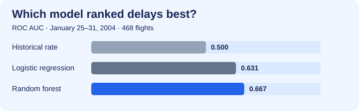

# Flight Delay Risk Predictor

**Can a flight schedule tell us anything about arrival delay risk?** This Streamlit demo estimates delay risk from the departure airport, destination, carrier, weekday, and scheduled departure hour. It shows the historical route delay rate beside each estimate and lets you compare observed departure hours for the same itinerary.



## What the model learned

On 468 flights from the final week of January 2004, the random forest produced a **0.667 ROC AUC** and a **0.202 Brier score**. Shuffling carrier or scheduled departure hour hurt its probability estimates most. This measures model reliance on those inputs in this sample.

| Model | ROC AUC ↑ | Average precision ↑ | Brier score ↓ |
| --- | ---: | ---: | ---: |
| Historical prevalence | 0.500 | 0.282 | 0.215 |
| Logistic regression | 0.631 | 0.391 | 0.206 |
| **Random forest** | **0.667** | **0.407** | **0.202** |

The test delay rate was 28.2%, compared with 11.1% in validation. The model showed modest ranking ability, and the change in delay prevalence illustrates why a probability model should be evaluated on later dates.

## Evaluation design

- **Data.** The [FlightDelays.csv teaching dataset](https://gist.github.com/nnbphuong/0160812678ad507a6b8a4ffc66eb3211) contains 2,201 Washington, DC area departures to New York from January 2004. The target is the supplied delayed-arrival label, described in the teaching material as more than 15 minutes late.
- **Timeline.** Fit on Jan 1–18 (1,265 rows), select between logistic regression and random forest by Brier score on Jan 19–24 (468 rows), refit through Jan 24, then score once on Jan 25–31 (468 rows).
- **Feature availability.** Inputs come from the schedule. Actual departure time, aircraft tail number, and the dataset's weather flag are excluded. The historical route benchmark uses rows through Jan 24.
- **Scope.** The dataset covers one corridor and one month. Estimates apply to this retrospective demo. The app compares observed schedule combinations and uses no live weather, airport congestion, or operational feeds.

## Run locally

Use Python 3.11 or newer. Download [FlightDelays.csv](https://gist.github.com/nnbphuong/0160812678ad507a6b8a4ffc66eb3211) using **Raw**, then save it as `data/FlightDelays.csv` inside the repository.

```bash
python -m pip install -r requirements.txt
python model.py
python -m streamlit run app.py
```

`model.py` prints the evaluation metrics. `app.py` provides the interactive risk explorer and holdout results. The dashboard was smoke-tested with Streamlit AppTest, including a change of origin airport.
